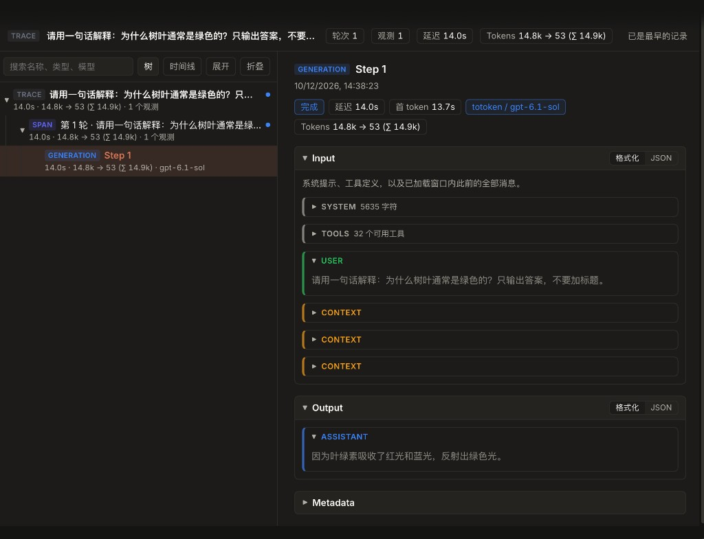

# dsh-trace-lens

[DeepSeek Harness](https://github.com/deepseek-ai/deepseek-harness)（dsh）插件：以 Langfuse 风格的 Trace 视图展示会话——轮次、模型调用和工具调用以树或时间线呈现，并显示每个观测的输入、输出和元数据。也可以导入离线 session 日志进行分析。

[English](README.md)



## 功能

- **Trace 标签**：出现在每个会话视图中。左侧列出整条 Trace，每轮一个 SPAN、每次模型调用一个 GENERATION、每次工具调用一个 TOOL，可在树和时间线之间切换。右侧显示选中观测的状态、延迟、首 token 时间、提供商和模型、Token 用量，以及格式化或原始 JSON 形式的输入、输出和元数据。
- **状态颜色**：模型调用失败的轮次标红；只有工具调用失败的轮次标黄；运行中为绿色；已结束为蓝色。
- **Session 分析**：位于设置中。导入 `session.v4.jsonl` 日志、其 `.zstd` 或 `.gz` 压缩文件，或 session 事件的 JSON 数组，并在全屏 Trace 视图中打开。导入的数据只保存在当前窗口内存中，不会写入本地会话。

## 安装

```sh
dsh plugin --profile <profile> add dsh-trace-lens
```

安装后重启 dsh。插件需要 Web 客户端（`dsh web` 或桌面版）。

## 开发

```sh
npm install
npm run build   # 由源码模块重新生成 client.js
npm test
```

`client.js` 由 `build.mjs` 生成并提交到仓库，因此安装插件无需构建。请修改 `data-model.js`、`session-import.js`、`view.js`、`import-view.js` 或 `steady-tabs.js`，然后重新构建。

在本地试用时，可以把检出目录链接到 profile：

```sh
dsh plugin --profile <profile> add link:/path/to/dsh-trace-lens
```

## 许可证

MIT
